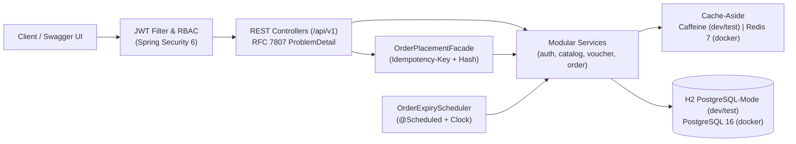
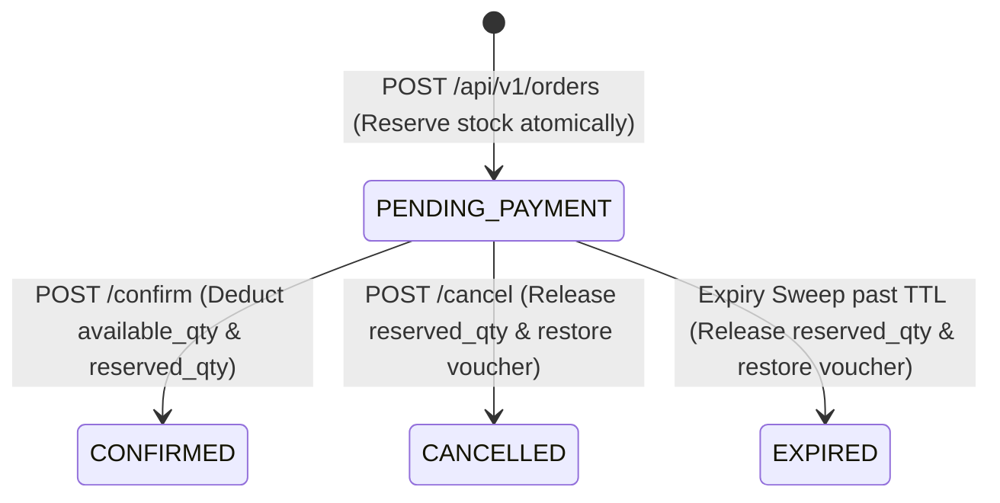

# Flash-Sale Order & Inventory Reservation API

> **One-sentence pitch:** A concurrency-safe RESTful backend API built with Java 21 and Spring Boot 3.4 that handles flash-sale product browsing, limited-quota vouchers, idempotent order checkout, and TTL-based inventory reservations without overselling.


---

## 1. Overview & Motivation

- **Problem:** Under flash-sale traffic spikes, naive read-modify-write order handlers suffer from three classic failures:
  1. **Overselling:** Concurrent checkout requests read stale stock counts before other transactions commit, driving inventory negative.
  2. **Zombie Inventory Locks:** Unpaid checkouts indefinitely hold scarce inventory when users abandon payment.
  3. **Duplicate Orders:** Unstable client networks retry `POST /api/v1/orders`, reserving stock twice for a single purchase intent.
- **Solution:** A **Modular Monolith** backed by ACID relational invariants: conditional atomic SQL updates with consistent lock ordering prevent oversells and deadlocks, `Idempotency-Key` snapshots prevent duplicate order creation, and a race-safe `@Scheduled` expiry processor releases abandoned holds back to sellable inventory.

---

## 2. System Architecture



### Order & Inventory Reservation Lifecycle



### Key Technical Highlights (What to Inspect)

- **Zero-Oversell Atomic Stock Reservation (`OrderService` & `InventoryItemRepository`):** Aggregates duplicate product lines into a `TreeMap` sorted by `productId ASC` (eliminating circular lock-order deadlocks) and reserves stock with a single conditional SQL update (`WHERE (available_qty - reserved_qty) >= :qty`) rather than in-memory read-modify-write.
  - See [OrderService.java](src/main/java/com/portfolio/flashsale/order/service/OrderService.java) and [InventoryItemRepository.java](src/main/java/com/portfolio/flashsale/inventory/repository/InventoryItemRepository.java).
- **Idempotent Checkout (`OrderPlacementFacade`):** Enforces a mandatory `Idempotency-Key` header paired with `UNIQUE(user_id, idempotency_key)` and a canonical SHA-256 request payload hash. Identical retries replay the exact stored `201 Created` JSON (`X-Idempotency-Replayed: true`), while differing payloads with the same key return `409 Conflict`.
  - See [OrderPlacementFacade.java](src/main/java/com/portfolio/flashsale/order/service/OrderPlacementFacade.java).
- **Limited-Quota Flash Vouchers (`VoucherService`):** Combines an atomic conditional update (`claimed_count < max_redemptions` inside the `[startsAt, endsAt]` window) with `UNIQUE(voucher_id, user_id)` so neither quota overruns nor duplicate user claims can occur under concurrency.
  - See [VoucherService.java](src/main/java/com/portfolio/flashsale/voucher/service/VoucherService.java) and [FlashVoucherRepository.java](src/main/java/com/portfolio/flashsale/voucher/repository/FlashVoucherRepository.java).
- **Race-Safe TTL Expiry & Deterministic Time (`OrderExpiryService` & `ClockConfig`):** Injects `java.time.Clock` across JWT issuance, voucher windows, and order TTLs so expiration is tested deterministically without `Thread.sleep()`. The expiry job transitions orders via an atomic conditional update (`PENDING_PAYMENT -> EXPIRED`) before releasing `reserved_qty`, ensuring concurrent confirm/cancel calls never double-release stock.
  - See [OrderExpiryService.java](src/main/java/com/portfolio/flashsale/order/service/OrderExpiryService.java).
- **JWT Rotation with Reuse Detection & RFC 7807 Errors:** Uses `BCrypt`, `jjwt` 0.12.7 Access Tokens, SHA-256 hashed Refresh Tokens rotated on each use (revoking the entire active user token family if an already-rotated token is replayed), and uniform RFC 7807 `ProblemDetail` payloads across both MVC and Security filters.
  - See [AuthService.java](src/main/java/com/portfolio/flashsale/auth/service/AuthService.java) and [GlobalExceptionHandler.java](src/main/java/com/portfolio/flashsale/common/exception/GlobalExceptionHandler.java).

---

## 3. Tech Stack

| Layer | Technology | Purpose |
| :--- | :--- | :--- |
| Language & Runtime | Java 21 LTS | Records, switch expressions, `java.time.Clock` |
| Framework | Spring Boot 3.4.13 (Web, Data JPA, Validation, Security, Cache, Actuator) | Modular Monolith REST API (`open-in-view: false`) |
| Auth & Security | Spring Security 6, `jjwt` 0.12.7, BCrypt | Stateless JWT Access + Refresh token rotation, RBAC (`ROLE_ADMIN`, `ROLE_CUSTOMER`) |
| Schema & Migrations | Flyway + ANSI/PostgreSQL SQL (`V1__init_schema.sql`) | Versioned DDL with `hibernate.ddl-auto: validate` |
| Persistence (Dual Profile) | H2 (`MODE=PostgreSQL`) in `dev`/`test` / PostgreSQL 16 in `docker` | Instant standalone local runs + production-parity Docker runtime |
| Caching (Dual Profile) | Caffeine (`dev`/`test`) / Redis 7 (`docker`) | Cache-Aside (`@Cacheable` / `@CacheEvict`) on catalog reads |
| API Documentation | Springdoc OpenAPI 2.8.17 | Interactive Swagger UI with Bearer JWT authorization |
| Testing & Tooling | JUnit 5, Mockito, `MockMvc`, Maven Wrapper (`mvnw` / `mvnw.cmd`) | Unit, API integration, deterministic `Clock`, and `CountDownLatch` concurrency tests |

---

## 4. Quick Start (Run Locally in < 3 Minutes)

### Option A: Standalone Run (JDK 21 Only — No Docker Required)

The default `dev` profile runs completely standalone using H2 in PostgreSQL compatibility mode, Flyway migrations, Caffeine cache, and deterministic seed data (`DevDataSeeder`).

```bash
# Windows
.\mvnw.cmd spring-boot:run

# macOS / Linux
chmod +x mvnw && ./mvnw spring-boot:run
```

### Option B: Full Stack via Docker Compose (PostgreSQL 16 + Redis 7)

```bash
cp .env.example .env
docker compose up --build
```

Assigned Docker host ports:
- **API:** `http://localhost:8101`
- **PostgreSQL 16:** `localhost:5431` -> container `5432`
- **Redis 7:** `localhost:6381` -> container `6379`

### Interactive Docs & Seeded Demo Data

- **Swagger UI:** `http://localhost:8101/swagger-ui.html`
- **Health Endpoint:** `http://localhost:8101/api/v1/health`
- **H2 Console (`dev` profile):** `http://localhost:8101/h2-console` (JDBC URL: `jdbc:h2:mem:flashsale`, User: `sa`, empty password)
- **Seeded Accounts (`dev` profile):**
  - Admin (`ROLE_ADMIN`): `admin@flashsale.local` / `Admin@1234`
  - Customer (`ROLE_CUSTOMER`): `demo@flashsale.local` / `Demo@1234`
  - Customer 2 (`ROLE_CUSTOMER`): `demo2@flashsale.local` / `Demo@1234`
- **Seeded Active Flash Vouchers:** `FLASH20` (20% off, min order `50.00`, quota `50`), `WELCOME15` (`15.00` off, min order `60.00`, quota `100`)

### API Endpoint Summary

| Module | Method & Path | Access | Description |
| :--- | :--- | :--- | :--- |
| Health | `GET /api/v1/health` | Public | Service, active profiles, and DB connectivity probe |
| Auth | `POST /api/v1/auth/register`, `/login`, `/refresh`, `/logout` | Public | Registration, login, refresh token rotation, revocation |
| Auth | `GET /api/v1/auth/me` | Authenticated | Current authenticated user profile |
| Catalog | `GET /api/v1/products`, `GET /api/v1/products/{id}` | Public | Paginated search/filter & cached product details |
| Admin Catalog | `POST/PUT /api/v1/admin/products`, `PATCH .../inventory` | `ROLE_ADMIN` | Manage products & adjust stock with `@Version` guard |
| Vouchers | `GET /api/v1/vouchers/active` | Public | List active campaigns in the current time window |
| Vouchers | `POST /api/v1/vouchers/{code}/claim`, `GET /my-claims` | Authenticated | Atomically claim limited voucher quota & list user claims |
| Admin Vouchers | `POST/GET /api/v1/admin/vouchers` | `ROLE_ADMIN` | Create & monitor flash voucher campaigns |
| Orders | `POST /api/v1/orders` | Authenticated | Idempotent checkout (`Idempotency-Key` header required) |
| Orders | `GET /api/v1/orders`, `GET /api/v1/orders/{id}` | Owner / Admin | Paginated order history & order details |
| Orders | `POST /api/v1/orders/{id}/confirm`, `POST .../cancel` | Owner / Admin | Confirm payment or cancel and release reserved stock |

---

## 5. Sample Workflow (`curl`)

```bash
# 1. Login as the seeded demo customer
TOKEN=$(curl -s -X POST http://localhost:8101/api/v1/auth/login \
  -H "Content-Type: application/json" \
  -d '{"email":"demo@flashsale.local","password":"Demo@1234"}' \
  | python -c "import sys,json; print(json.load(sys.stdin)['accessToken'])")

# 2. Browse active products & claim a flash voucher
curl -s http://localhost:8101/api/v1/products?size=3
curl -s -X POST http://localhost:8101/api/v1/vouchers/FLASH20/claim \
  -H "Authorization: Bearer $TOKEN"

# 3. Create an order with Idempotency-Key (retrying with the same key replays safely)
curl -i -X POST http://localhost:8101/api/v1/orders \
  -H "Authorization: Bearer $TOKEN" \
  -H "Idempotency-Key: demo-checkout-001" \
  -H "Content-Type: application/json" \
  -d '{"items":[{"productId":1,"quantity":1}],"voucherCode":"FLASH20"}'

# 4. Confirm payment on order #1
curl -s -X POST http://localhost:8101/api/v1/orders/1/confirm \
  -H "Authorization: Bearer $TOKEN"
```

---

## 6. Testing & Verification

Run the full unit, API integration, and multi-threaded concurrency test suite locally without Docker:

```bash
# Windows
.\mvnw.cmd -B verify

# macOS / Linux
./mvnw -B verify
```

### Measured Verification Summary (`40` Tests Passing, `0` Failures, `0` Skipped)

| Test Suite | Tests | What It Verifies |
| :--- | :---: | :--- |
| `ApplicationContextIntegrationTest` | 2 | Full Spring context, Flyway `V1` schema on H2 PostgreSQL-mode, `ddl-auto: validate`, `/api/v1/health`, `/v3/api-docs` |
| `GlobalExceptionHandlerTest` | 3 | RFC 7807 `ProblemDetail` payloads for domain conflicts, validation field errors, and missing headers |
| `DevDataSeederTest` | 2 | Idempotent dev seeding on empty DB and skip behavior when users already exist |
| `JwtServiceTest`, `AuthServiceTest`, `AuthIntegrationTest` | 12 | JWT generation/expiry via `Clock`, refresh rotation, token-family revocation on reuse, logout, `401`/`403` RBAC |
| `CatalogServiceTest`, `CatalogIntegrationTest` | 6 | Pagination/filtering, duplicate SKU `409`, `@Version` optimistic lock guard, Caffeine Cache-Aside population & eviction |
| `VoucherServiceTest`, `VoucherConcurrencyIntegrationTest` | 5 | Discount math, time-window guard, duplicate claim `409`, **30 concurrent threads claiming quota=5 -> 5 `201` & 25 `409`** |
| `OrderServiceTest`, `OrderConcurrencyIntegrationTest` | 6 | `Idempotency-Key` replay & payload mismatch `409`, owner isolation `403`, confirm/cancel transitions, **50 concurrent threads buying 10 items -> 10 orders, 40 `409`, 0 oversells** |
| `OrderExpiryServiceTest`, `OrderExpiryIntegrationTest` | 4 | Deterministic `Clock` TTL expiry without `Thread.sleep`, voucher restoration, concurrent confirm/expiry race safety, malformed JSON `400` |

---

## 7. Project Structure

```text
src/
├── main/
│   ├── java/com/portfolio/flashsale/
│   │   ├── common/          # AppProperties, ClockConfig, CacheConfig, OpenApiConfig, SchedulerConfig, DevDataSeeder, RFC 7807 GlobalExceptionHandler, HealthController
│   │   ├── auth/            # User, RefreshToken, Role, JwtService, JwtAuthenticationFilter, SecurityConfig, SecurityProblemHandler, AuthService, AuthController
│   │   ├── catalog/         # Product, ProductRepository (@EntityGraph), ProductSpecifications, CatalogService, ProductController, AdminProductController
│   │   ├── inventory/       # InventoryItem (@Version), InventoryItemRepository (atomic reserve/confirm/release queries)
│   │   ├── voucher/         # FlashVoucher, VoucherClaim, DiscountType, VoucherService, VoucherController, AdminVoucherController
│   │   └── order/           # Order, OrderItem, IdempotencyRecord, OrderPlacementFacade, OrderService, OrderExpiryService, OrderExpiryScheduler, OrderController
│   └── resources/
│       ├── application.yml, application-dev.yml, application-test.yml, application-docker.yml
│       └── db/migration/V1__init_schema.sql
└── test/
    └── java/com/portfolio/flashsale/  # 14 unit, MockMvc integration, Clock TTL, and CountDownLatch concurrency test suites
```

---

## 8. Future Improvements & Known Tradeoffs

- **Hot-SKU Contention at High Scale:** The current design relies on PostgreSQL row-level locks during the conditional `UPDATE inventory_items` statement, which is optimal for ACID correctness in a Modular Monolith. At extreme flash-sale scale (>1,000 RPS on a single SKU), a Redis Lua pre-decrement gate or partitioned queue can absorb spikes in front of the relational database.
- **Transactional Outbox for Notifications:** Order confirmation and expiration currently update state synchronously in a single ACID transaction; adding an outbox table with a background publisher would decouple email/push notifications without distributed 2-phase commits.
- **Idempotency Record Pruning:** In long-running production deployments, a periodic cleanup job should archive or purge `idempotency_records` older than 24–72 hours.
